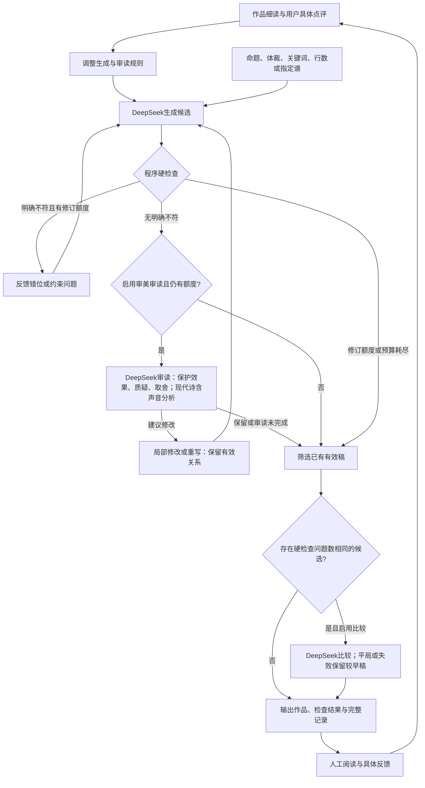

# 当前工作流

研发层：有出处的作品细读与用户对具体诗句的反馈，形成可修正的审美判断，落实到生成提示、审读提示、规则与改稿程序；再通过真实生成及人工反馈迭代。当前没有模型参数训练，朗读不在此阶段。

每次compose最多两次修订，硬错误修订与审美修订共享额度；时间预算也共享。文学审读可选，默认不启用；仅在没有已知硬错误且还允许修订时发起。--candidates可设1至3，各候选独立执行上述流程并共享总预算；跨候选还会比较同等硬检查状态的稿件。单次compose内部的文学比较依审美开关；跨独立候选的比较在非mock且预算充足、硬问题数相同时进行，即使未启用--aesthetic也会发生。

硬检查核格式、必用禁用词，以及指定谱与当前韵书资料能判定的明确冲突；unknown不冒充通过。所有稿仍有问题时输出needs_review，不把最少问题稿当成合格定稿。核音表可在生成后通过离线入口按精确正文逐字复核，尚未自动并入生成循环。

DeepSeek负责语言生成、文学审读与比较；Python Agent负责调用次序、硬检查、预算、有限修订、候选筛选及记录。审读与比较仍是模型自评，最终文学偏好由实际阅读反馈检验。源码、作品和证据同步至私有VERSEFORGE仓库。
